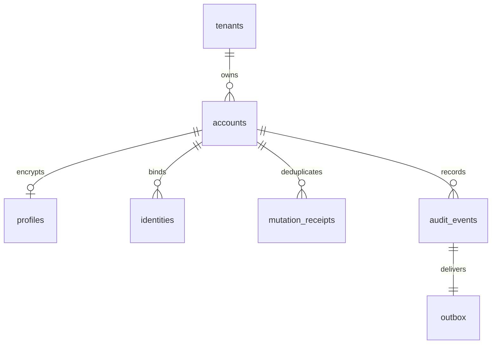

# 用户数据库插件与部署

## 范围与插件边界

后端由多个 Cordis 插件组合。用户存储是独立能力，不依赖视频、骨架、动作库或评分插件，也不把数据库逻辑放入运行时。

| 插件 | 服务 | 职责 |
| --- | --- | --- |
| [PostgresPlugin](../src/plugins/postgres.ts) | `fitnessDatabase` | PostgreSQL 16+ 连接池、TLS、同连接事务、查询与事务预算、卸载关闭连接 |
| [UserDataProtectionPlugin](../src/plugins/user-data-protection.ts) | `fitnessUserDataProtection` | 个人资料与身份标识的 AES-256-GCM 加解密、独立 HMAC 检索指纹、密钥版本 |
| [UserDatabasePlugin](../src/plugins/user-database.ts) | `fitnessUsers` | 租户内用户资料、登录身份、状态、版本、幂等回执、审计与事务 outbox |

[用户契约](../src/user-contracts.ts)与[数据库契约](../src/database-contracts.ts)是消费边界。消费方依赖服务名称，不导入具体提供方。当前没有用户 HTTP 路由、密码登录、JWT、权限管理或支付功能；该服务面向受信任的后端插件，不能直接暴露给客户端。

[独立装配清单](../src/user-app.ts)可以单独挂载。现有应用只有显式设置 `FITNESS_USERS_ENABLED=true` 才加入这三个插件；否则既有视频/JSON 流程保持可独立使用。启用后，缺少配置、迁移、合适的运行角色或正确密钥会阻止服务启动，不回退为内存用户库。

## 数据模型

模式名固定为 `fitness_users`。所有时间使用 PostgreSQL `timestamptz`，公开数据为 UTC ISO 8601 字符串；标识为随机 UUID；整数版本在每次用户变更后递增。



| 表 | 内容与约束 |
| --- | --- |
| `tenants` | 客户/学校/部署空间；需管理员显式创建，不自动接受客户端传入的新租户 |
| `accounts` | 账号 UUID、租户、`active/suspended/deleted`、版本、创建/更新时间、删除时间；不以手机号或邮箱作为主键 |
| `profiles` | 加密 JSON，内含显示名、语言、时区、头像资源 UUID；删除后物理移除资料行 |
| `identities` | 独立登录身份，支持 `email`、`phone`、自定义 OIDC 等 provider；subject 加密，唯一约束为租户 + provider + HMAC 指纹 |
| `mutation_receipts` | `operationId`、HMAC 请求摘要、用户与应用版本、相关身份 ID；没有原始请求、姓名、邮件或电话快照 |
| `audit_events` | 仅记录事件类型、用户 ID、版本、操作主体 ID、操作 ID 和时间；运行账号只有追加与查询权限 |
| `outbox` | 与审计事件同事务创建；租约拥有者、随机 token、过期时间与确认时间，用于可靠投递 |
| `key_registry` | 独立检索密钥的固定校验值，启动时检测错误更换密钥；不保存密钥原文 |
| `schema_migrations` | 有序版本、名称、SQL SHA-256、应用时间；运行账号只能查询 |

`accounts` 及其子表使用包含租户 ID 的复合主/外键，数据库因此拒绝将 A 租户的身份或资料挂到 B 租户账号。身份唯一性在数据库中执行，两个进程同时注册相同身份时，失败方的账号、资料、回执与事件一起回滚。同一邮箱可存在于不同租户，它们是独立账号；当前没有跨租户账号合并功能。

## 租户与访问边界

业务表启用并强制 PostgreSQL RLS。每次服务调用使用同一个数据库连接开启事务，通过 `set_config('fitness.tenant_id', tenantId, true)` 设置仅本事务有效的租户，再校验租户存在。没有租户上下文时，租户表默认不返回数据；连接池归还连接后不会保留本次事务的租户设置。

RLS 防止遗漏过滤条件与跨租户外键错误。运行账号必须不是超级用户、`BYPASSRLS`、建库/建角色者，也不能拥有数据库或用户模式；插件启动会检查这些条件和业务表的强制 RLS。迁移和授权使用另一套独立凭据。

服务的 `tenantId`、`actorId` 和 `verified` 来自受信任的后端调用者。未来认证/授权插件必须根据已认证身份确定租户与操作权限，不能直接相信 HTTP 请求体中的这些字段。持有同一数据库运行凭据的插件属于同一信任边界，RLS 不是防御恶意插件或运行凭据被盗的独立授权系统。

## 用户数据与身份语义

资料接口接受完整 `UserProfile`：`displayName`（1–100 字符）、BCP 47 `locale`、可识别的 IANA `timeZone`、`avatarAssetId`（UUID 或 null）。不在当前账号表中收集身份证、学校学号、生日、健康记录或原始视频；将来需要时由对应业务插件定义最少字段、访问与保留范围。

邮箱采用产品级大小写不敏感策略：去除首尾空格、local part 与域名小写、国际域名转 ASCII；不移除 Gmail 点号、不合并加号地址。电话要求带 `+` 的国际号码、8–15 位数字。其他 provider 的 subject 保留大小写和原始内容，防止错误合并外部账号。

身份的 `verified` 是认证适配器的声明。`create` 可建立未验证身份；对同一用户重新 `linkIdentity` 同一身份会更新其验证状态并沿用身份 ID，不会转移其他用户的身份。数据库插件不发送验证码、不验证密码或 OIDC token。`findByIdentity` 也可返回暂停或未验证账号，认证消费方必须检查账号状态和对应身份验证状态。

公开 `UserAccount` 不包含身份 subject。只有受信任服务显式调用 `readIdentitySubject` 才解密返回邮箱、电话或外部标识。普通列表/详情返回加密资料解密后的 DTO 与身份元数据；它们仍是个人数据，需要未来接口层授权，不能当作公开目录。身份查找将归属条件、账号资料和身份列表放在同一条 SQL 的快照中，避免并发解绑时拼出不一致的归属。资料与身份文本拒绝孤立 UTF-16 surrogate，防止 UTF-8 加密替换字符后与 HMAC 检索不一致。

## 并发、重试与事务

每次写入要求 `mutation: { actorId, operationId }`，其中 `operationId` 为调用方生成并保存的 UUID。重试相同逻辑操作时复用该值。其他变更要求 `expectedVersion`，数据库行锁和版本比较共同阻止丢失更新。

同一租户的同一 `operationId` 用事务级 advisory lock 串行化，规范化请求经独立 HMAC 摘要后写入回执。相同请求重试不重复修改、不重复产生事件；相同 ID 换请求内容则返回 `IDEMPOTENCY_CONFLICT`。重试返回的 `user` 是当前视图，`appliedVersion` 是原操作应用的版本，两者可能不同；这不保证返回历史资料快照。

事务中同时提交用户、身份、审计、outbox 和回执。任一步失败都会回滚。SQL 使用参数化值；只有部署命令的角色名进入标识符位置，并进行严格白名单验证。

连接建立、锁等待、SQL、整个事务均有时间预算。插件卸载拒绝新操作并销毁在途数据库连接，失效的事务会话不能继续查询。网络在 `COMMIT` 期间断开时返回 `DATABASE_TRANSACTION_UNKNOWN`，不会自动把同一写入当作新操作重试；调用方应复用原 `operationId` 来确认结果。

## 加密和密钥轮换

个人资料整体及每个身份 subject 使用独立随机 12 字节 IV 的 AES-256-GCM，加密结果为 `v1.<kid>.<iv>.<ciphertext>.<tag>`，各二进制部分为规范 base64url，tag 为 16 字节。AAD 包含格式域、租户、用户、字段类型及身份 ID/provider，因此复制密文到其他用户或字段会认证失败。

身份检索与幂等摘要使用另一个 256 位 HMAC-SHA-256 密钥；输入包括无歧义的上下文。检索指纹按租户和 provider 隔离。加密 keyring 能读旧 key、用当前 active key 写新数据，`reencrypt` 按用户在事务内重加密资料和身份，不改变检索指纹；它也要求版本和幂等操作标识。

配置见 [.env.example](../.env.example)：

- `FITNESS_USER_ENCRYPTION_KEYS`：JSON 对象，`kid` 到 32 字节、无填充 base64url 密钥的映射。
- `FITNESS_USER_ENCRYPTION_ACTIVE_KEY`：当前写入的 `kid`。
- `FITNESS_USER_LOOKUP_KEY`：独立 32 字节 base64url HMAC 密钥，禁止复用任意加密 key。

没有内置默认密钥。运行时卸载会清零持有的密钥 Buffer，密钥不作为可枚举服务属性暴露；JavaScript 字符串与运行进程的全部内存并不因此获得可证明的彻底擦除。生产密钥应由密钥管理系统注入，独立备份和限制访问，不写进源码、镜像、数据库或日志。

轮换时先保留旧 key 并加入新 key，切换 active key，再通过用户服务逐项 `reencrypt`；确认所有在线数据和需要保留的备份不再依赖旧 key 后才移除。HMAC 检索密钥不能按普通加密 key 直接替换：数据库的固定校验会拒绝启动，更换它需要专门的双索引/重建迁移，目前没有自动轮换工具。

## 状态、擦除与事件

状态为 `active`、`suspended`、`deleted`。暂停可恢复，删除通过 `erase` 执行并禁止恢复；删除会物理移除资料与身份密文，解除身份唯一性占用，保留只有标识与操作信息的账号墓碑、幂等回执和审计。重试历史创建操作仍返回墓碑，不重新创建已删除用户。

这覆盖在线用户库的个人资料删除，不代表旧备份、WAL、数据库空闲页、下游服务或对象存储数据已立刻消失。生产环境必须给这些副本确定保留期限与删除流程。审计中的 UUID 与 actor ID 仍是可关联标识，需要按实际业务制定保留期限，不能宣称为完全匿名数据。

`fitness/user-changed` 是提交后的尽力唤醒通知，订阅者失败不回滚已提交的数据。可靠消费使用 `claimChanges`、`acknowledgeChange`：`FOR UPDATE SKIP LOCKED` 防止同时领取同一未过期租约，确认必须匹配 worker 与随机租约 token，过期后可重新领取。因此消息是至少一次语义，消费方按 `event.id` 去重。

当前 outbox 是一个逻辑消费队列，多个 worker 协同处理；它不保证按用户版本顺序投递，也不提供每个插件独立订阅的消费组。未来分发插件应将已领取事件路由给需要的消费者，并在下游完成后确认；消费方可按版本忽略旧事件或查询用户当前状态。

## 部署与显式迁移

需要 Node.js 24+、PostgreSQL 16+，生产使用仍受维护的 PostgreSQL 补丁版本。驱动固定为 `pg@8.23.1`，以锁文件安装。

1. 准备专用数据库和两个独立角色。迁移角色拥有用户模式及 DDL 权限；运行角色使用 `LOGIN NOSUPERUSER NOCREATEDB NOCREATEROLE NOINHERIT NOBYPASSRLS`，不拥有数据库/模式，不加入所有者角色。凭据通过部署的密钥系统设置。
2. 设置 `FITNESS_DATABASE_MIGRATION_URL`，执行 `pnpm users:db migrate`。迁移使用 advisory lock、有序记录与 SQL SHA-256；重复执行不会重复建表，修改已应用迁移或遇到未知版本会拒绝。应用启动不会自动执行 DDL。
3. 执行 `pnpm users:db grant <运行角色名>`，授予模式 USAGE、必要 DML、审计/回执追加和 outbox 租约列更新权限；不授予 CREATE、TRUNCATE、账号硬删除或审计修改权限。该命令不创建数据库角色，也不替代对已有额外权限的审查。
4. 注入三项加密配置，执行 `pnpm users:db key-init`。已初始化的身份检索密钥校验不能被该命令覆盖。
5. 执行 `pnpm users:db tenant-create <租户UUID> <名称>`。应由运营管理流程生成租户，不从未经授权的客户端请求创建。
6. 设置 `FITNESS_DATABASE_URL` 为运行角色连接，执行 `pnpm users:db check`。成功后可独立挂载 [userDatabasePlugins](../src/user-app.ts)，或通过 `FITNESS_USERS_ENABLED=true` 加入现有应用。

默认 `FITNESS_DATABASE_TLS=verify-full`，验证服务端证书及主机名，私有 CA 用 `FITNESS_DATABASE_CA_FILE` 注入。只有显式 `local` 且 URL 主机为 loopback/localhost 才允许关闭 TLS，供本机开发和测试使用；远程连接不接受此设置。不接受 URL 查询参数，防止 `sslmode` 等覆盖明确 TLS 配置。

程序不自动读取 `.env`。可以由部署系统设置环境变量，或使用 Node 的 `--env-file`：

```sh
node --env-file=.env src/user-db-main.ts migrate
node --env-file=.env src/user-db-main.ts check
node --env-file=.env src/main.ts --help
```

构建会复制 SQL 迁移，编译后的管理入口为 `node dist/user-db-main.js ...`。普通业务环境只保留运行凭据，迁移凭据仅注入受控部署步骤。对外用户接口尚未实现，不应把这些管理命令做成公开 HTTP 接口。

## 使用契约

```ts
// 受信任后端插件：static inject = ['fitnessUsers']
const created = await ctx.fitnessUsers.create({
  schemaVersion: '1.0', tenantId,
  profile: { displayName: '示例用户', locale: 'zh-CN', timeZone: 'Asia/Shanghai', avatarAssetId: null },
  identity: { provider: 'email', subject: 'user@example.invalid', verified: false },
  mutation: { actorId: 'system:registration', operationId },
});
const user = await ctx.fitnessUsers.get(tenantId, created.user.id);
const updated = await ctx.fitnessUsers.updateProfile({
  schemaVersion: '1.0', tenantId, userId: created.user.id, expectedVersion: created.user.version,
  profile: { ...created.user.profile!, displayName: '新的显示名' },
  mutation: { actorId: created.user.id, operationId: nextOperationId },
});
```

其他接口包括 `list`（UUID keyset 分页，默认 active，最多 100）、`changeStatus`、`linkIdentity`、`unlinkIdentity`、`findByIdentity`、`readIdentitySubject`、`erase`、`reencrypt`、`claimChanges`、`acknowledgeChange`。所有业务输入都做运行时校验，未知字段被拒绝，错误不包含连接串、明文资料、SQL 参数或原始数据库错误详情。

## 验证与仍需完成的部署工作

隔离测试命令：

```powershell
$env:FITNESS_TEST_PG_BIN = '<PostgreSQL bin directory>'
pnpm test:database
```

该命令生成随机临时凭据，在忽略版本跟踪的 `artifacts/` 内初始化仅监听 loopback 的 PostgreSQL 集群，用随机空闲端口和 SCRAM 认证运行集成测试，最后停止该集群；不连接或改动本机已有数据库。测试数据库文件、日志及虚构资料的备份留作证据。没有 PostgreSQL 二进制时明确失败，不把跳过集成测试计为通过。

已执行最终 `pnpm check`：类型检查、73 项 Node.js 测试、ESM 构建通过，包含既有动作/视频契约回归、用户输入配置与 14 项加密测试。

已执行最终 `pnpm test:database`：PostgreSQL 18.2 隔离实例中的 **21 项真实集成测试全部通过**，包含源码和编译后管理命令，覆盖迁移校验和、密文存储、跨租户读写/外键、运行角色权限、并发唯一身份、幂等、并发版本、身份归属、擦除、分页、outbox 竞争及过期、审计失败回滚、密钥轮换、会话/超时/卸载与提供方重挂。

自审发现并修复了连接借出后的 error 监听、提交不确定时连接销毁、COMMIT 返回 ROLLBACK 标签、身份查找双查询快照和孤立 surrogate 输入五项边界。回归实际调用 `pg_terminate_backend` 中断在途查询及延迟约束触发器执行期间的 COMMIT，验证受控错误/UNKNOWN、进程继续运行、后续新连接健康。另确定性交错身份查找与解绑，验证单语句快照。

测试实际执行 `pg_dump --format=custom` 与 `pg_restore --exit-on-error`，恢复到另一数据库后，用受限运行账号通过用户插件成功解密读取测试资料，并核对跨租户查询仍受限。最终备份及日志位于 [测试证据目录](../artifacts/user-database-test-1792132249310-97052e82/)，简要验证清单见 [verification.json](../artifacts/user-database-test-1792132249310-97052e82/verification.json)。

测试不能代替部署环境中的认证授权、数据库网络隔离、密钥托管、容量压测、PITR/故障切换、异地加密备份与恢复演练。本次范围是用户数据库模块，不宣称整个项目已经通过商业生产验收。

机制参考：[node-postgres 事务](https://node-postgres.com/features/transactions)、[连接池与释放](https://node-postgres.com/apis/pool)、[TLS 配置覆盖规则](https://node-postgres.com/features/ssl)、[PostgreSQL RLS](https://www.postgresql.org/docs/18/ddl-rowsecurity.html)。
